# Evidencias de VetTurno

Evidencias del taller evaluativo Java AI Engineer, módulo 3 (Backend profesional con Spring Boot), organizadas por parte. Cada captura tiene un nombre fijo, una descripción en texto y, cuando el taller lo pide, una explicación con mis propias palabras.

## Índice

1. [Enlaces](#enlaces)
2. [Parte 1 — Preparar el proyecto](#parte-1--preparar-el-proyecto)
3. [Parte 2 — Modelar la información](#parte-2--modelar-la-información)
4. [Parte 3 — Flujo REST por capas](#parte-3--flujo-rest-por-capas)
5. [Parte 4 — Agendar citas sin cruces](#parte-4--agendar-citas-sin-cruces)
6. [Parte 5 — JWT y roles](#parte-5--jwt-y-roles)
7. [Parte 6 — Validaciones y errores](#parte-6--validaciones-y-errores)
8. [Parte 7 — Documentar, probar y publicar](#parte-7--documentar-probar-y-publicar)
9. [Lista de verificación final](#lista-de-verificación-final)

## Enlaces

| Elemento                      | Enlace                                                                           |
| ----------------------------- | -------------------------------------------------------------------------------- |
| Repositorio                   | [https://github.com/TU_USUARIO/vetturno](https://github.com/TU_USUARIO/vetturno) |
| Matriz de 15 pruebas manuales | [docs/pruebas.md](../pruebas.md)                                                 |
| README principal              | [README.md](../../README.md)                                                     |

Commits de cada parte:

| Parte | Descripción del commit                                          | Enlace                                                                                                                                              |
| ----- | --------------------------------------------------------------- | --------------------------------------------------------------------------------------------------------------------------------------------------- |
| 1     | chore: iniciar VetTurno                                         | [https://github.com/joshcastro06/VetTurno/commit/Parte 1](https://github.com/joshcastro06/VetTurno/commit/3a817d1ddbc74f38d598313648ce0e54d09787ba) |
| 2     | feat: modelar entidades y repositorios                          | [https://github.com/joshcastro06/VetTurno/commit/Parte 2](https://github.com/joshcastro06/VetTurno/commit/b4e21e6c5975f632e24609912c8e647d2c8e9a76) |
| 3     | feat: crear flujo REST de propietarios, mascotas y veterinarios | [https://github.com/joshcastro06/VetTurno/commit/Parte 3](https://github.com/joshcastro06/VetTurno/commit/1713af0b99325bc6d9804d4ad689c7b8cb34c787) |
| 4     | feat: agendar citas sin cruces de horario                       | [https://github.com/joshcastro06/VetTurno/commit/Parte 4](https://github.com/joshcastro06/VetTurno/commit/5a1b1d1e8cdb7a9776d2188100af82156a52731c) |
| 5     | feat: agregar autenticación JWT y roles                         | [https://github.com/joshcastro06/VetTurno/commit/Parte 5](https://github.com/joshcastro06/VetTurno/commit/68f7a62e3586fb040366ca0799f6e88d0ca6ca2b) |
| 6     | feat: validaciones y manejo global de errores                   | [https://github.com/joshcastro06/VetTurno/commit/Parte 6](https://github.com/joshcastro06/VetTurno/commit/536e35055a35594159d944237f48f93fa6d5250e) |
| 7     | docs: Swagger, matriz de pruebas y README final                 | [https://github.com/TU_USUARIO/vetturno/commit/HASH_PARTE_7](https://github.com/TU_USUARIO/vetturno/commit/HASH_PARTE_7)                            |

## Parte 1 — Preparar el proyecto

**Punto de control:** VetTurno compila, el servidor inicia, los paquetes son legibles y el primer commit contiene una base limpia, sin credenciales ni archivos generados.

### Inicio correcto del servidor

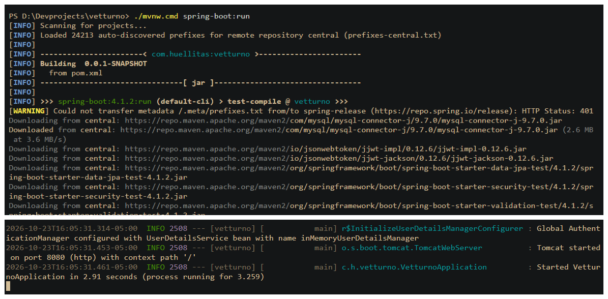

Descripción: consola de PowerShell tras ejecutar `./mvnw.cmd spring-boot:run`. Se ve el mensaje `Started VetTurnoApplication`, que confirma que el servidor embebido y la conexión con MySQL funcionan.

### Árbol de paquetes

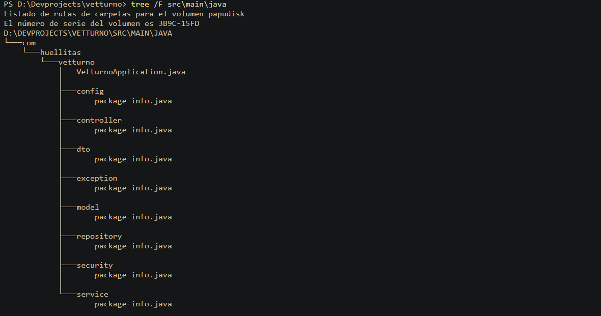

Descripción: estructura del código con los paquetes `model`, `repository`, `service`, `controller`, `dto`, `security`, `config` y `exception` dentro del paquete base `com.huellitas.vetturno`.

### Commit inicial

Enlace: ver la tabla de commits, fila de la Parte 1.

### Diferencia entre `pom.xml` y la main class

**pom.xml (Configuración y Construcción):** Es el archivo declarativo de Maven. Define la "receta" del proyecto: versión de Java, dependencias externas (Spring Data JPA, JJWT, MySQL, etc.) y plugins necesarios para descargar librerías, compilar y empaquetar el código. 

**Main Class (VetturnoApplication) (Punto de Entrada en Ejecución):** Es código Java con el método main(). Al ejecutarse, arranca el servidor web embebido, crea el contenedor de Spring, gestiona la inyección de dependencias y pone a funcionar la aplicación. 

## Parte 2 — Modelar la información

**Punto de control:** Hibernate crea o actualiza el esquema; las llaves foráneas aparecen en `mascotas` y `citas`; el modelo no contiene relaciones innecesarias y los repositorios compilan.

### Diagrama del modelo

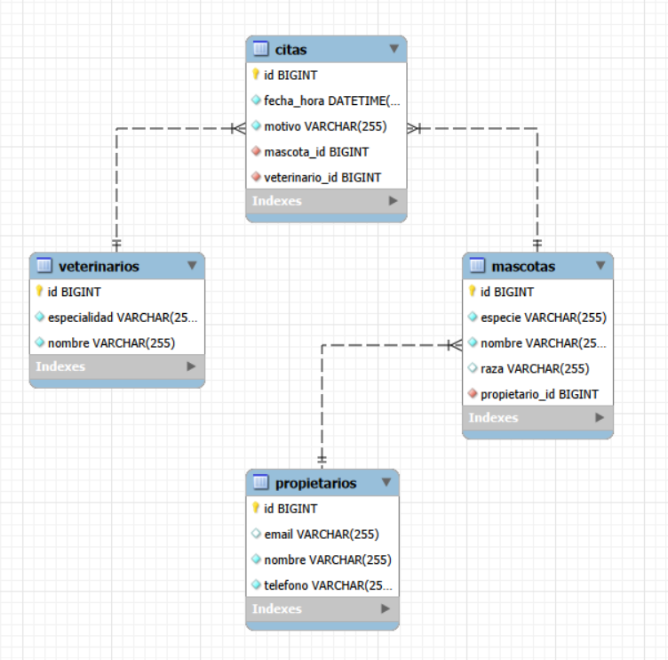

Descripción: un propietario tiene muchas mascotas; una mascota tiene muchas citas; un veterinario tiene muchas citas. Las llaves foráneas están en el lado "muchos": `mascotas.propietario_id`, `citas.mascota_id` y `citas.veterinario_id`.

### SQL generado al iniciar

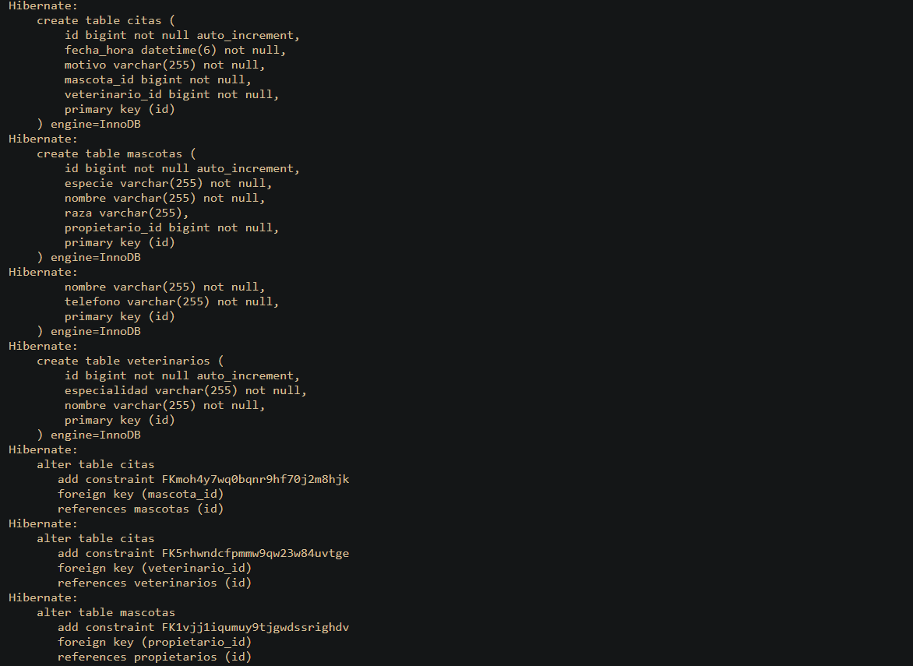

Descripción: consola de la aplicación con los `create table` de las cuatro tablas y los `alter table ... foreign key` que Hibernate ejecutó al arrancar.

### Tablas en MySQL Workbench

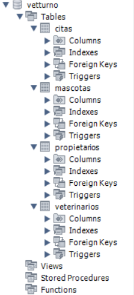

Descripción: MySQL Workbench conectado a la instancia local, con el esquema `vetturno` y las tablas `citas`, `mascotas`, `propietarios` y `veterinarios`, con sus columnas y llaves foráneas.

### Diferencia entre JPA, Hibernate y JpaRepository

**JPA (Jakarta Persistence API):** Es la especificación o estándar (el plano arquitectónico). Es un conjunto de interfaces y anotaciones (@Entity, @Table, @Id) que definen cómo debe funcionar el mapeo objeto-relacional en Java, pero no contiene código ejecutable para interactuar con la base de datos.

**Hibernate:** Es la implementación real del estándar (la constructora que sigue los planos). Es la librería que lee las anotaciones de JPA y ejecuta físicamente las sentencias SQL (INSERT, SELECT, UPDATE) contra MySQL.

**JpaRepository:** Es una abstracción de alto nivel de Spring Data JPA. Es una interfaz de Spring que entrega métodos CRUD ya implementados (save(), findById(), findAll(), etc.) para que no tener que escribir consultas SQL ni manipular manualmente el EntityManager de JPA.

## Parte 3 — Flujo REST por capas

**Punto de control:** una secuencia de peticiones crea un propietario, su mascota y un veterinario; las respuestas usan DTO; los datos sobreviven al reinicio; ninguna relación produce recursión JSON.

### Creación de las tres entidades

Descripción: `POST /api/propietarios` en Swagger UI. Responde 201 y devuelve el propietario con su `id`.

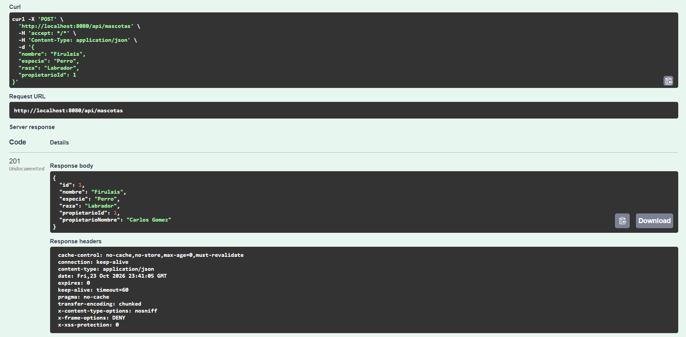

Descripción: `POST /api/mascotas` con el `propietarioId` del paso anterior. Responde 201.

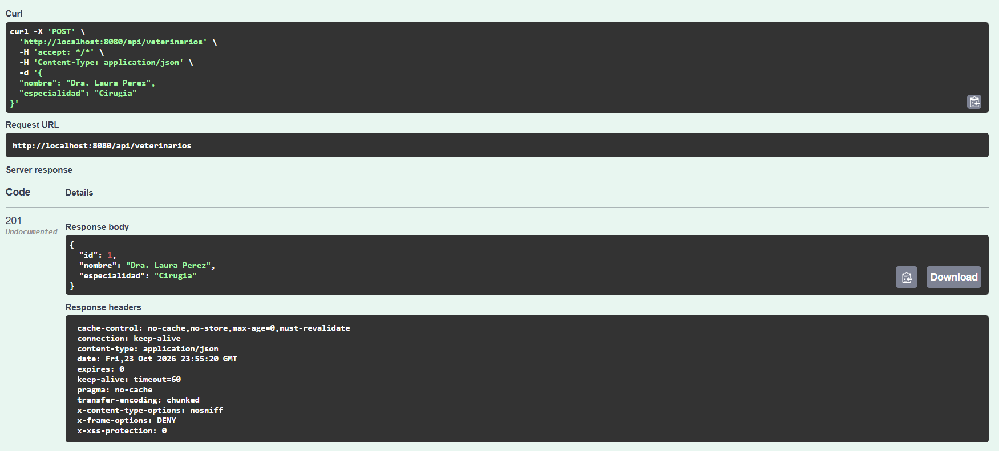

Descripción: `POST /api/veterinarios`. Responde 201 con `id`, `nombre` y `especialidad`.

### Consulta de las tres colecciones

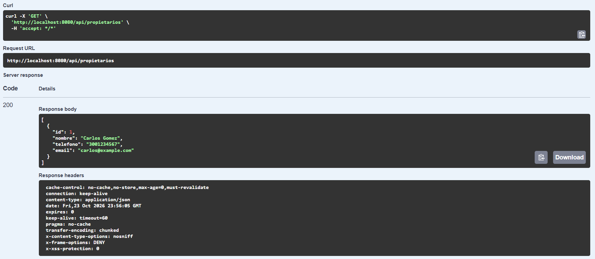
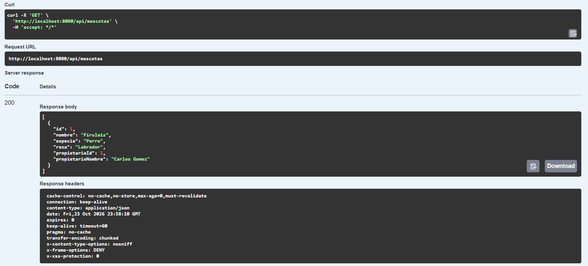
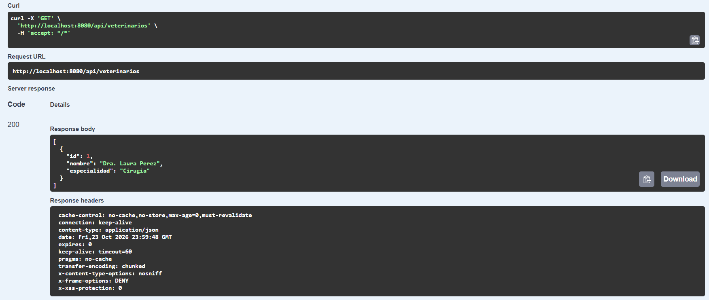
Descripción: los tres `GET` responden 200 y muestran los registros creados.

### Mascota con información breve del propietario

Descripción: la respuesta de la mascota identifica al propietario solo con `propietarioId` y `propietarioNombre`, sin colecciones anidadas ni ciclos.

### Persistencia al reiniciar el servidor

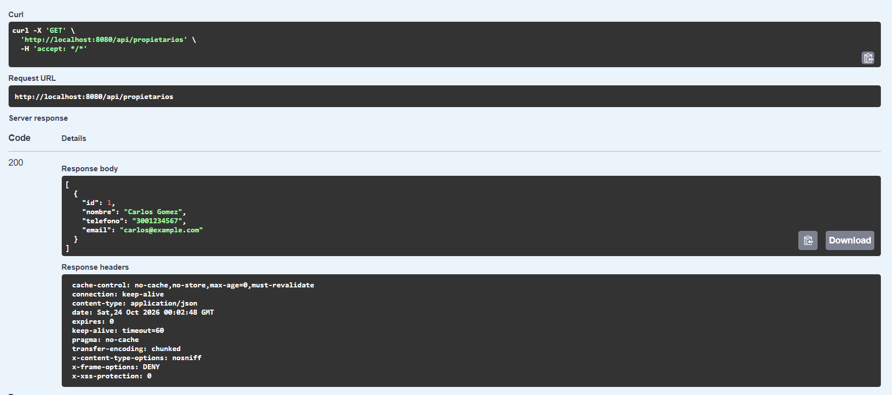
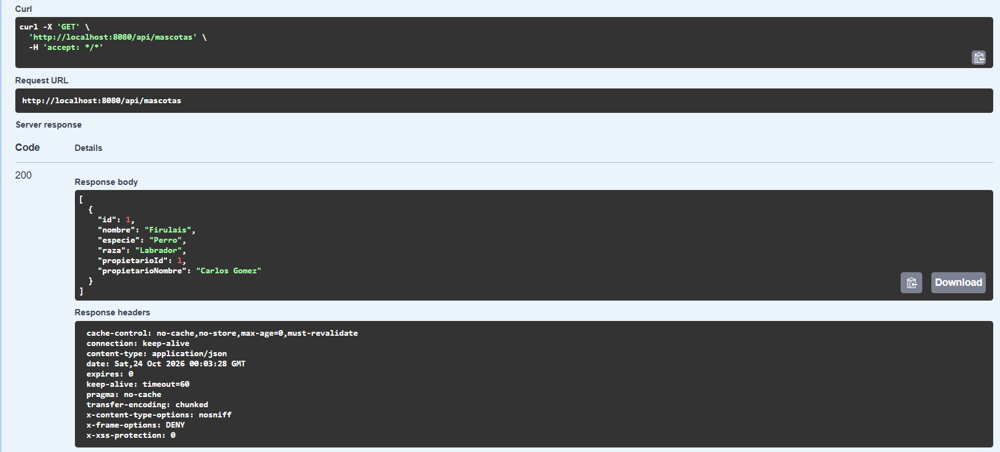
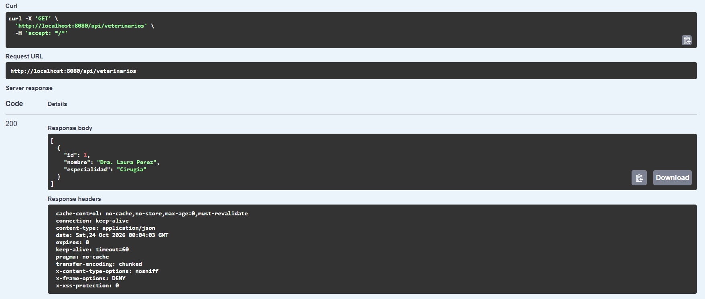

Descripción: los mismos `GET` después de reiniciar, con los mismos registros y los mismos `id`.

## Parte 4 — Agendar citas sin cruces

**Punto de control:** VetTurno agenda una cita futura, rechaza el cruce de horario y devuelve la agenda por veterinario con datos planos.

### Cita válida

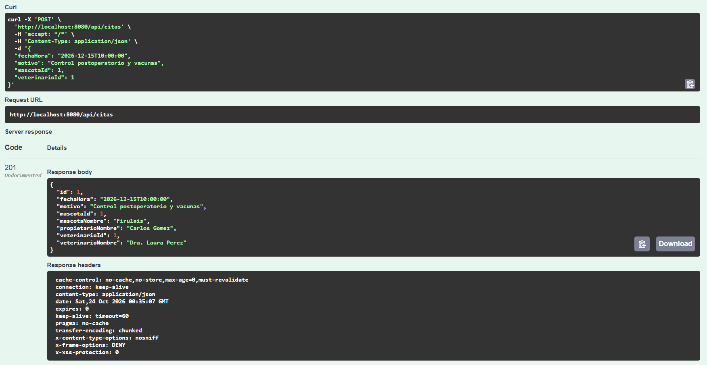

Descripción: `POST /api/citas` con una fecha futura, una mascota y un veterinario existentes. Responde 201.

### Fecha pasada

Descripción: `POST /api/citas` con una fecha anterior a hoy. Responde 400 y no se guarda nada.

### Horario duplicado

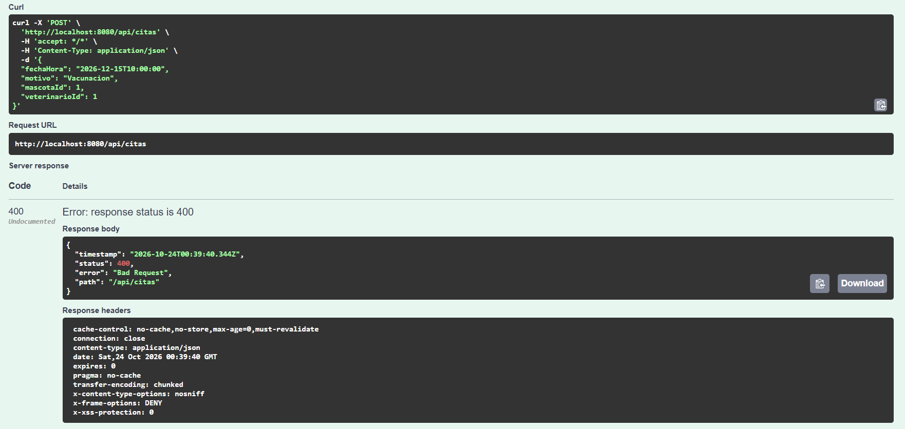

Descripción: `POST /api/citas` con el mismo veterinario y la misma `fechaHora` que una cita existente. Responde 400.

### Filtro por veterinario

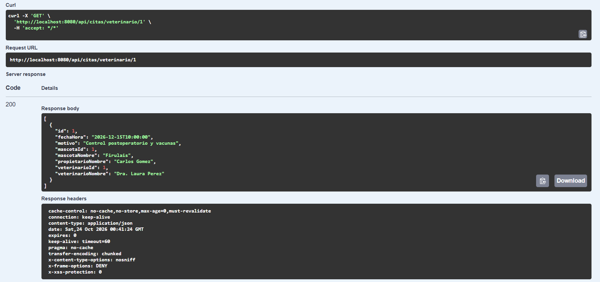

Descripción: `GET /api/citas/veterinario/{id}` devuelve solo las citas del veterinario indicado.

## Parte 5 — JWT y roles

**Punto de control:** el login entrega un JWT utilizable; la contraseña es ilegible en MySQL; USER recibe 403 al registrar veterinarios y ADMIN completa la misma operación con 201.

### Hash de la contraseña en MySQL

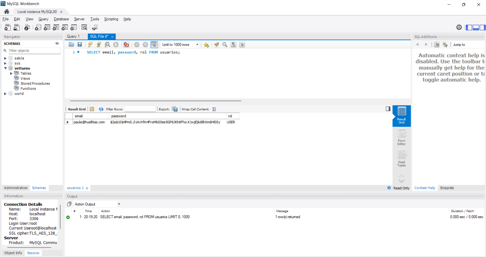

Descripción: consulta `SELECT email, password, rol FROM usuarios`. La columna `password` muestra un hash BCrypt, no la contraseña original, y el rol del registro es `USER`.

### Login con token

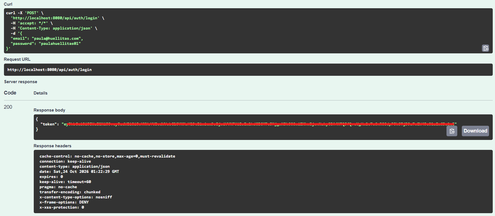

Descripción: `POST /api/auth/login` responde 200 y devuelve el token. Una parte del token está tapada.

### Permiso por rol: USER contra ADMIN

Petición con **USER**
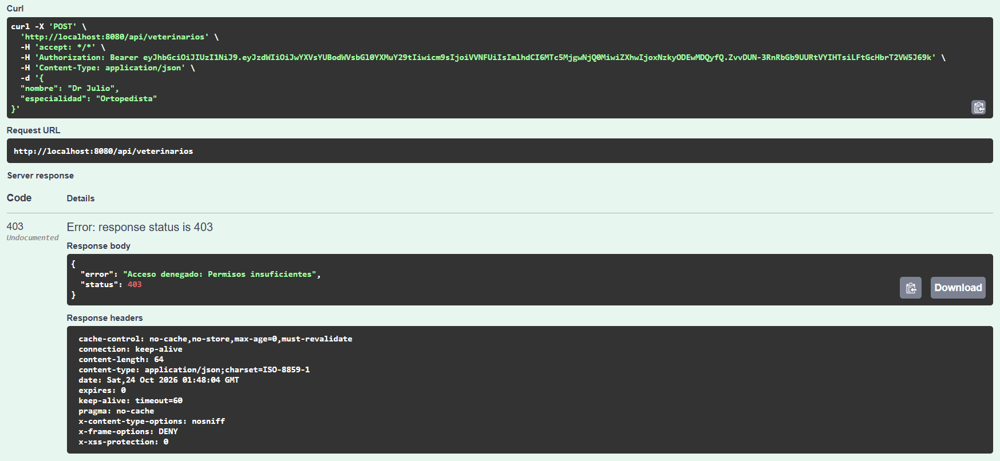
Petición con **ADMIN**
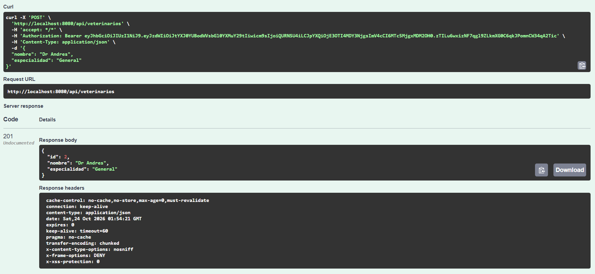
Descripción: comparación de la misma petición, `POST /api/veterinarios`. Con el token de Paula (USER) responde 403; con el token de Doña Marta (ADMIN) responde 201.

## Parte 6 — Validaciones y errores

**Punto de control:** MySQL no recibe registros inválidos; las respuestas 400 explican qué corregir; un error inesperado no expone detalles internos.

### Error 400 con varios campos

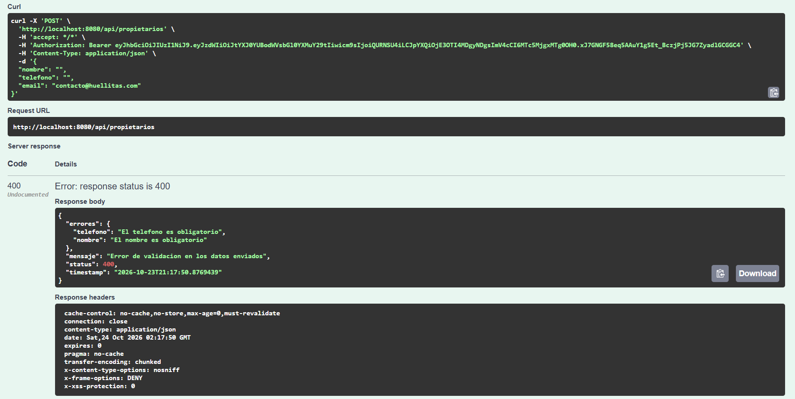

Descripción: petición con campos vacíos o inválidos. La respuesta tiene el formato `ApiError` con `status`, `mensaje`, errores por campo y `timestamp`.

### Error 400 por cruce de horario

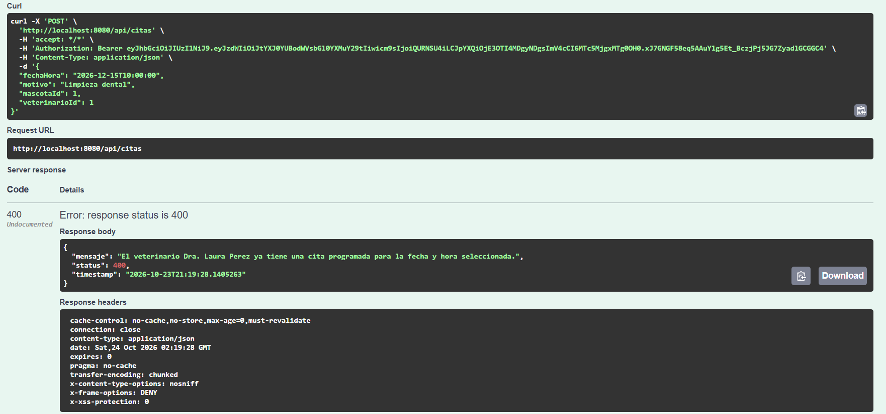

Descripción: intento de agendar una cita para un veterinario en un horario ya ocupado. Responde 400 con un mensaje claro en el mismo formato `ApiError`.

### ¿Por qué el manejador global no reemplaza las reglas de seguridad?

La seguridad actúa antes del controller: Spring Security valida el token y el rol, y rechaza con 401 o 403. El manejador global solo entra en acción cuando una excepción ocurre dentro del controller o del service, y la convierte en una respuesta ApiError. Por eso no puede reemplazar las reglas de seguridad: llegaría tarde y no tiene el contexto de quién hace la petición.

## Parte 7 — Documentar, probar y publicar

**Punto de control:** una persona que no conoce el código puede clonar VetTurno, configurarlo, iniciar sesión, probar el flujo desde Swagger y comprender los resultados mediante el README.

### Swagger con la información de VetTurno

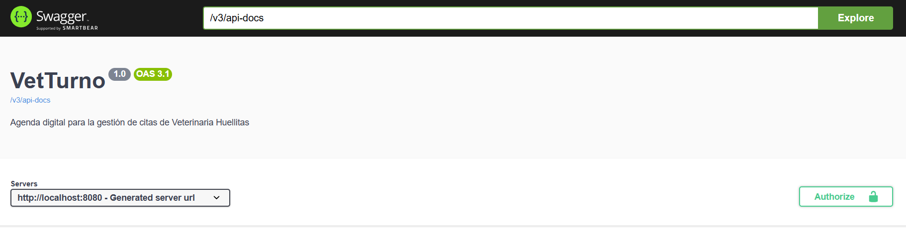

Descripción: Swagger UI muestra el nombre VetTurno, la descripción de Veterinaria Huellitas y el botón Authorize para pegar el token JWT.

### Matriz de pruebas manuales

La matriz completa, con el resultado real de las 15 pruebas, está en [Archivo de matriz](docs/matriz/matriz.md).