# Plan de Pruebas y Matriz de Verificación - VetTurno

Este documento contiene la matriz de pruebas funcionales, de seguridad y de persistencia de la agenda digital **VetTurno** de Veterinaria Huellitas.

### Matriz de Ejecución de Pruebas

# Pruebas manuales de VetTurno

Matriz mínima de 15 pruebas manuales del taller, ejecutadas en Swagger UI sobre la versión publicada de VetTurno (Veterinaria Huellitas). Cada prueba indica su escenario, el resultado esperado y la captura con el resultado real.

## Prueba 1 — Arranque con MySQL

**Escenario:** la aplicación inicia con MySQL disponible.

**Resultado esperado:** servidor activo y esquema accesible.

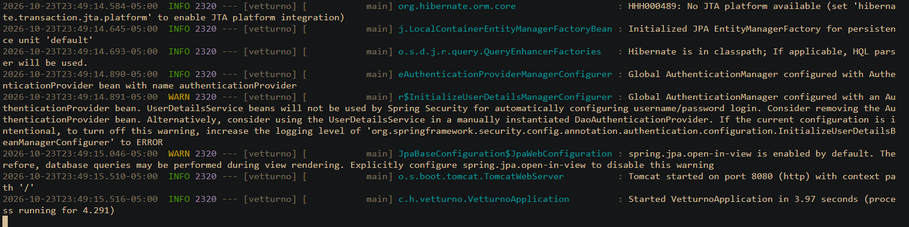

Descripción: [COMPLETAR, por ejemplo: consola con el mensaje de arranque correcto y la conexión a la base vetturno.]

## Prueba 2 — Registro válido de Paula

**Escenario:** registro válido de Paula.

**Resultado esperado:** 200 y token; contraseña hasheada.

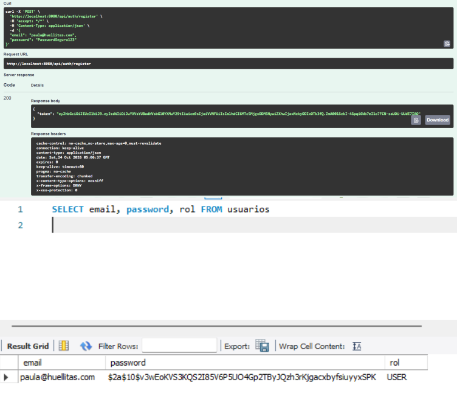

## Prueba 3 — Registro con email inválido y clave corta

**Escenario:** registro con email inválido y clave corta.

**Resultado esperado:** 400 con errores por campo.

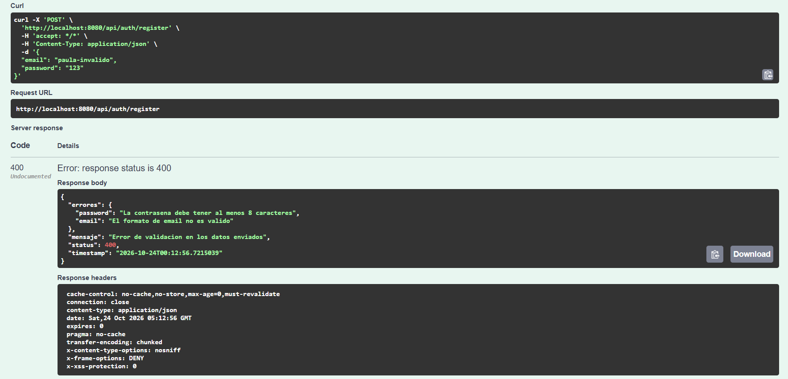

## Prueba 4 — Login con credenciales válidas

**Escenario:** login con credenciales válidas.

**Resultado esperado:** 200 y JWT vigente.

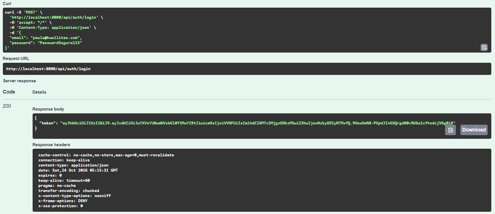

## Prueba 5 — GET /api/citas sin token

**Escenario:** `GET /api/citas` sin token.

**Resultado esperado:** acceso rechazado.

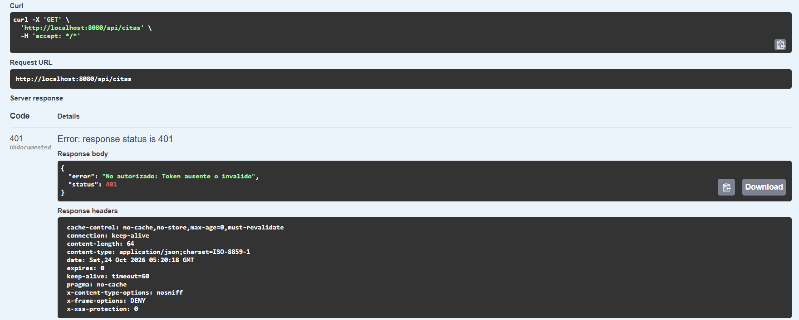

## Prueba 6 — POST /api/veterinarios con USER

**Escenario:** `POST /api/veterinarios` con USER.

**Resultado esperado:** 401 Forbidden.

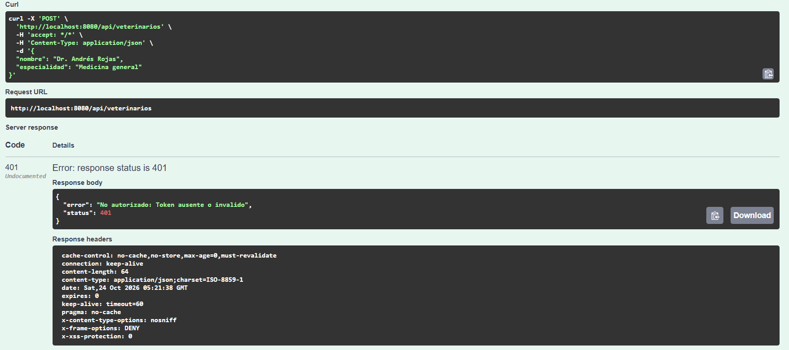

## Prueba 7 — POST /api/veterinarios con ADMIN

**Escenario:** `POST /api/veterinarios` con ADMIN.

**Resultado esperado:** 201 y veterinario persistido.

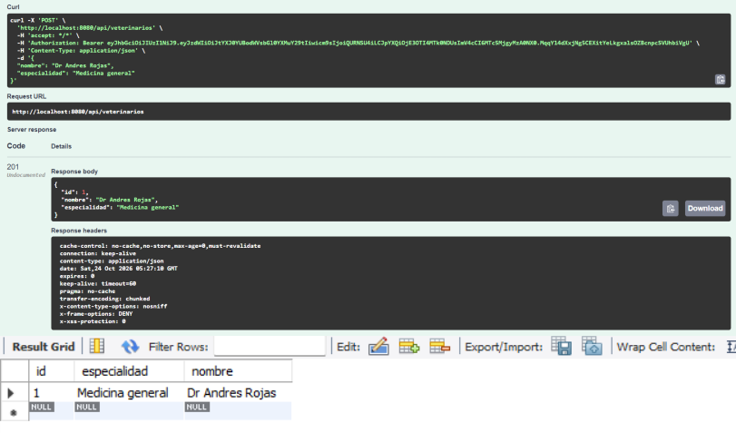

## Prueba 8 — Creación válida de propietario

**Escenario:** creación válida de propietario.

**Resultado esperado:** 201 y DTO sin colecciones anidadas.

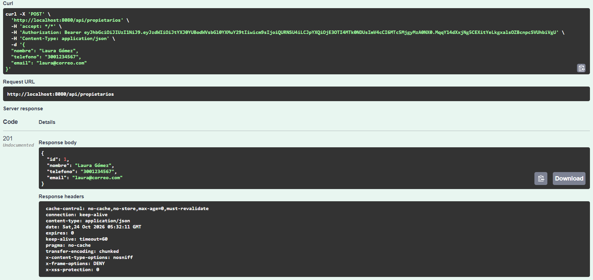

## Prueba 9 — Mascota con propietario existente

**Escenario:** creación de mascota con propietario existente.

**Resultado esperado:** 201 y relación correcta.

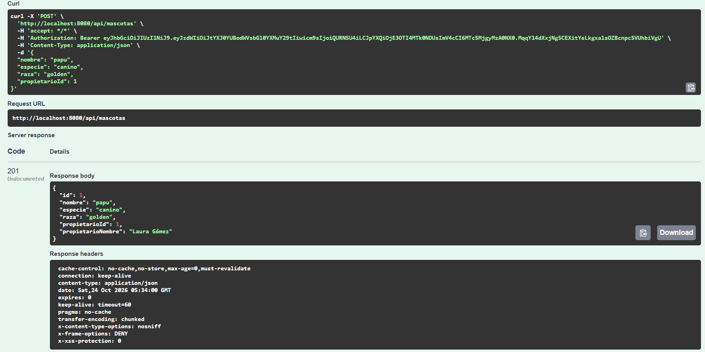

## Prueba 10 — Mascota con propietario inexistente

**Escenario:** mascota con propietario inexistente.

**Resultado esperado:** 400 controlado; no se inserta fila.

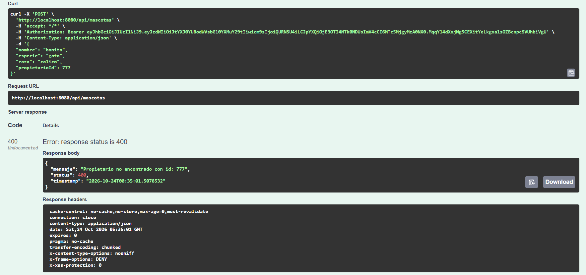

## Prueba 11 — Cita futura con referencias válidas

**Escenario:** cita futura con referencias válidas.

**Resultado esperado:** 201 y cita persistida.

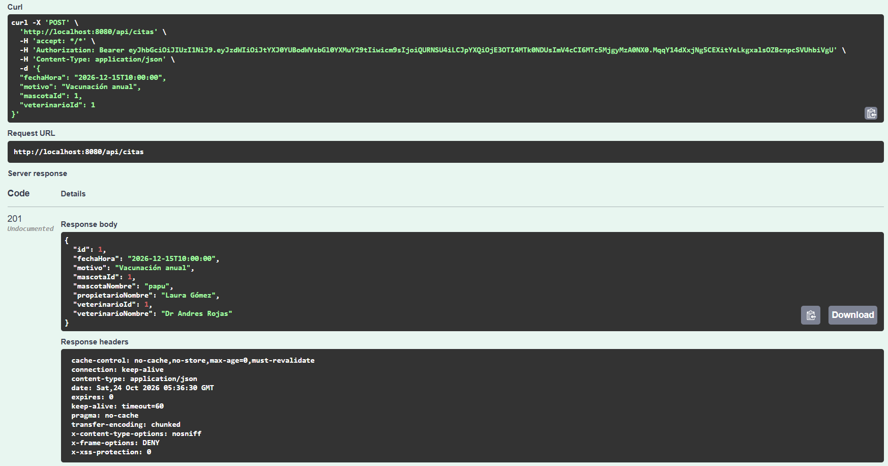

## Prueba 12 — Cita con fecha pasada

**Escenario:** cita con fecha pasada.

**Resultado esperado:** 400 con mensaje claro.

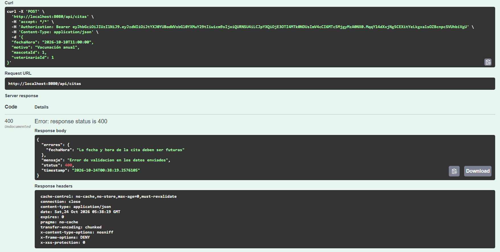

## Prueba 13 — Segundo intento con el mismo veterinario y horario

**Escenario:** segundo intento con el mismo veterinario y horario.

**Resultado esperado:** 400; se conserva una sola cita.

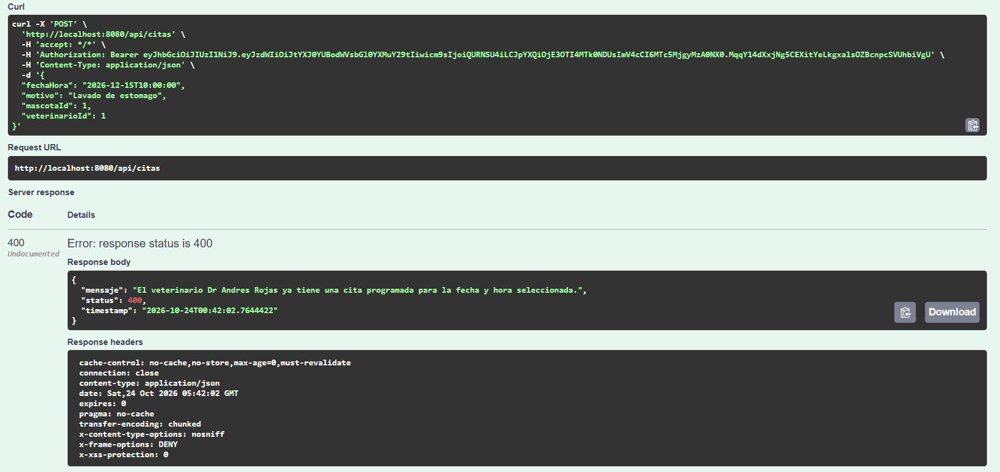

## Prueba 14 — Filtro de citas por veterinario

**Escenario:** filtro de citas por veterinario.

**Resultado esperado:** 200 y solo coincidencias.

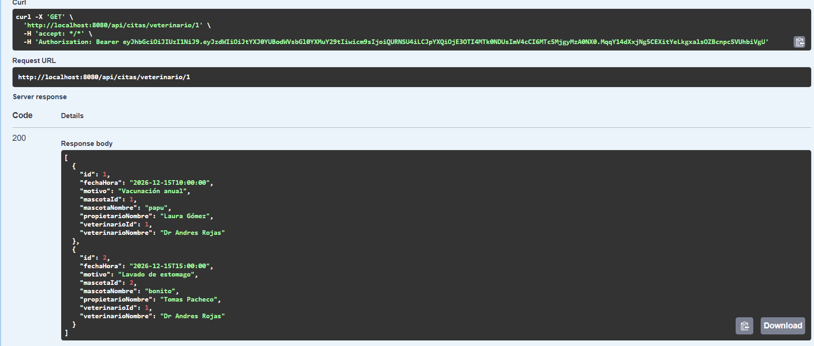

## Prueba 15 — Reinicio y prueba desde Swagger con Authorize

**Escenario:** reinicio y prueba desde Swagger con Authorize.

**Resultado esperado:** datos persisten y flujo protegido funciona.

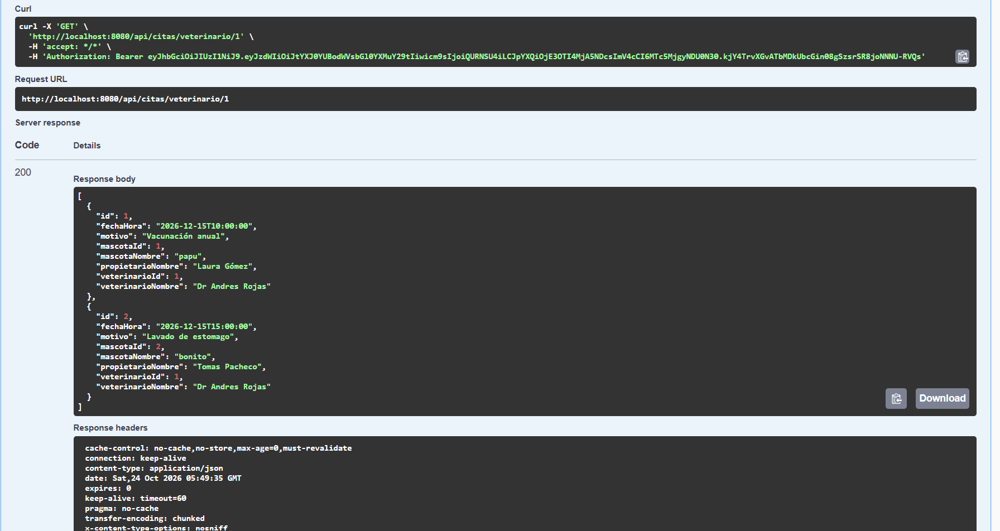
